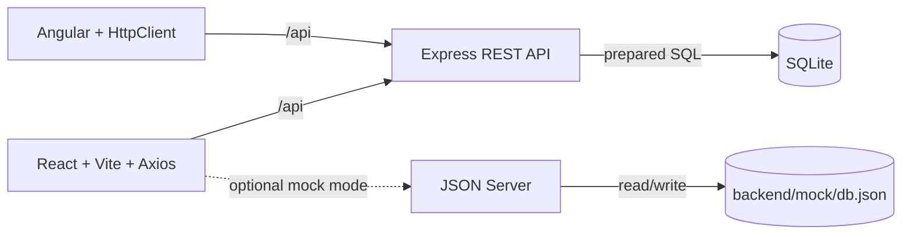

# Architecture

The workspace contains two independently runnable frontends and one persistent API. Both frontends exchange JSON with the Express API; the React development client can optionally use JSON Server instead.

## Runtime modes

- **SQL mode (default):** `npm run dev` starts Express on port 3001 and React/Vite on port 5173. Vite proxies `/api` to Express; Express initializes `data/employees.sqlite` from `database/schema.sql` and seeds an empty database from `database/seed.sql`.
- **JSON Server mock:** `npm run dev:mock` starts JSON Server on port 3002 and Vite with the mock environment. Axios adapts the mock's collection response into the same list/overview shapes used by React. Vite proxies `/mock-api` to JSON Server. Mock records live in `backend/mock/db.json` and are intentionally denormalized for easy UI prototyping.
- **Angular:** `npm run dev:angular` starts the separate Angular client on port 4200. It proxies `/api` to the SQL API and uses Angular `HttpClient`.

## Employee changes

Create and update operations are transactional. Core employee details and dependent contact/address/emergency-contact records are committed together. A changed salary or status adds a dated row to its history table. Delete sets `deleted_at`, hiding the person from normal directory queries while retaining their employee and history records.

The API validates required fields, email format, employment type, status, and salary. SQLite foreign keys protect department, role, manager, and dependent-record relationships. This is a local development scaffold; authentication, authorization, audit controls, encryption-at-rest policy, and production deployment configuration still need to be added before handling real personnel data.