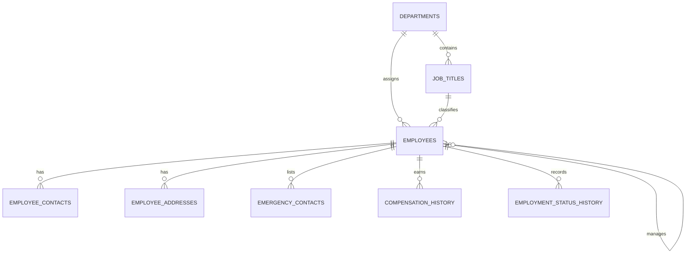

# Database design

The SQLite schema is defined in [`../database/schema.sql`](../database/schema.sql); [`../database/seed.sql`](../database/seed.sql) inserts example departments, roles, and employees. The database file is generated at `data/employees.sqlite` the first time the API starts.

| Table | Purpose | Important relationships / constraints |
| --- | --- | --- |
| `departments` | Organization groups and cost centers | Unique department name and cost center |
| `job_titles` | Department-specific roles and salary bands | Department foreign key; unique title within a department |
| `employees` | Identity, reporting, work assignment, and lifecycle | Unique employee code/email; self-referencing manager; constrained status and employment type |
| `employee_contacts` | Work, mobile, and alternate phone numbers | Cascades with employee; unique type/value per employee |
| `employee_addresses` | Home and mailing addresses | Cascades with employee; one address per type and employee |
| `emergency_contacts` | Emergency contact people and contact methods | Cascades with employee; supports multiple contacts |
| `compensation_history` | Salary and currency at each effective date | Cascades with employee; non-negative salary; unique employee/effective date |
| `employment_status_history` | Employment status changes and notes | Cascades with employee; unique employee/effective date |

## Data behavior

- Employee edits and related contact changes run in a single SQLite transaction.
- Salary and status changes append history rows; unchanged values do not create duplicate entries.
- Employee deletion is a soft delete (`employees.deleted_at`) so reporting history remains available.
- Department and role deletion is restricted while employee records reference them.
- `data/*.sqlite*` files are local runtime data and excluded from version control.

The JSON Server mock stores a denormalized representation in `backend/mock/db.json`; it is for UI prototyping and is not a substitute for these SQL constraints or relational history.